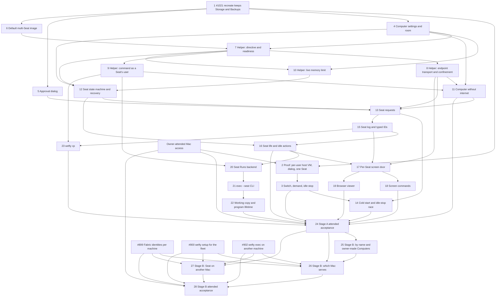

# Computer request implementation wave draft

This is paste-ready issue text, not implementation. It builds the spec `docs/specs/2026-10-21-computer-request-spec.md` (map [#1008](https://github.com/Derek-X-Wang/wefty/issues/1008), destination ticket [#1019](https://github.com/Derek-X-Wang/wefty/issues/1019)). Titles are stable dependency keys: copy every `Blocked by:` title exactly when you create the GitHub dependency edges. Ticket 1 already exists as [#1021](https://github.com/Derek-X-Wang/wefty/issues/1021). Create the other tickets only after the owner ratifies the spec.

> **Status:** draft for ratification, with the spec; all open points answered 2026-10-22. This wave is M3.7 **phase 3** (owner, 2026-10-22): the fleet work is phase 2 and Buzz is phase 4.

## Wave rules

- **Order: #1021 first; the proof before any ticket that builds on the per-user host VM.** [#1021](https://github.com/Derek-X-Wang/wefty/issues/1021) must land before any delivery work that sets up or recreates the host VM ([#1019](https://github.com/Derek-X-Wang/wefty/issues/1019)). The proof ticket (Ticket 2) blocks the host VM ticket (Ticket 3), and through it the cold-start ticket (Ticket 14) and the stage A acceptance (Ticket 24). Tickets that do not touch the host VM setup wait only on Ticket 1 or on their own code dependencies. Stage B tickets come last.
- **Beside the fleet work.** Stage A starts once the owner ratifies the spec, beside the phase-2 fleet work, because it does not need it. Like the fleet work, it does not wait for the phase-1 exit ([#897](https://github.com/Derek-X-Wang/wefty/issues/897)). The owner's Mac runs one test-heavy worker at a time, shared with the fleet work.
- **Stage B tickets that cross Macs carry the fleet dependencies** [#899](https://github.com/Derek-X-Wang/wefty/issues/899), [#900](https://github.com/Derek-X-Wang/wefty/issues/900) and [#902](https://github.com/Derek-X-Wang/wefty/issues/902), and come after those fleet tickets. Stage A tickets do not ([#1018](https://github.com/Derek-X-Wang/wefty/issues/1018)). The *by name* ticket (Ticket 25) runs on one Mac, needs no fleet ticket, and starts after the stage A acceptance (owner, 2026-10-22).
- **Size.** Each ticket fits about one AI agent session and lands its own acceptance slice.
- **One primary owner per check.** Each acceptance check in spec section 11 has exactly one primary owning ticket, which makes it pass and first proves it. Other tickets and lanes may add secondary evidence (see "Acceptance owners" below).
- **Tests check what an owner or an AI agent can see:** files, commands, exit codes, CLI output, L1 state and Seat log lines. Each new test fails on the code before the change ([#893](https://github.com/Derek-X-Wang/wefty/issues/893), testing decisions).
- **Lanes** (spec, section 11.1). Every code ticket grows the tagged `service_acceptance` suite. Linux runtime behaviour also grows the real-time Linux lane. Mac behaviour is proved only in attended runs on the owner's Mac, each with the owner's approval, at a quiet time, with the memory guard on. GitHub's Mac runners cannot run a VM. A check that could not run is `NOT-RUN`, never PASS.
- **Docs land with their code:** contracts, OpenAPI, schema, state machines, helper protocol, CLI usage and the wefty skill. A contract-doc change also runs the contract tests in `./scripts`.
- **A new exit code** needs a typed-exit whitelist entry and a real-binary test (#893, seam 1).
- **No ticket adds** a `kind=computer`, a `computers` CLI family, a wait queue, a wefty MCP server, a CDP relay, a proxy or a DNS and IP filter in the guest, public ingress, a second removal state machine, or a door for a sandbox that blocks the wefty socket.
- **No open points remain** (spec, section 12.3). Each "proposed" mechanism (spec, section 13.2) is built as written once the owner ratifies the spec.
- **Vocabulary.** Write "AI agent" and "node agent", never a bare "agent". Never call a Computer a VM.
- **Commits** are DCO-signed and have a why body.

## Decisions this wave rests on

All are closed: charting decisions 1–14 on map [#1008](https://github.com/Derek-X-Wang/wefty/issues/1008), and tickets [#1014](https://github.com/Derek-X-Wang/wefty/issues/1014), [#1017](https://github.com/Derek-X-Wang/wefty/issues/1017), [#1025](https://github.com/Derek-X-Wang/wefty/issues/1025), [#1052](https://github.com/Derek-X-Wang/wefty/issues/1052), [#1026](https://github.com/Derek-X-Wang/wefty/issues/1026), [#1028](https://github.com/Derek-X-Wang/wefty/issues/1028), [#1015](https://github.com/Derek-X-Wang/wefty/issues/1015), [#1016](https://github.com/Derek-X-Wang/wefty/issues/1016), [#1027](https://github.com/Derek-X-Wang/wefty/issues/1027) and [#1018](https://github.com/Derek-X-Wang/wefty/issues/1018), plus the owner's answers of 2026-10-22 (spec, section 12.3). The spec's section 12 links each decision; its section 12.2 records the settled points, which the owner accepted, and the review round 2 resolutions.

The wave has 28 tickets: 1 existing ticket, 1 proof ticket, 22 stage A tickets and 4 stage B tickets.

## Ticket list

| # | Title | Blocked by |
|---|---|---|
| 1 | #1021 Host VM recreate keeps the Computers' Storage and Backups | — |
| 2 | Proof: the host VM, a dialog and one Seat from the per-user install on the owner's Mac | 1 |
| 3 | Host VM switch with three positions, node-owned demand and a gentle idle stop | 2 |
| 4 | Computer settings and room per Seat | 1 |
| 5 | The owner's approval dialog on the Mac | 1 |
| 6 | Default multi-Seat Computer image and Seat conformance | 1 |
| 7 | Helper: Seat directive and per-Seat readiness | 4, 6 |
| 8 | Helper: per-Seat endpoint transport and confinement | 7 |
| 9 | Helper: a command as a Seat's user inside a running Computer | 7 |
| 10 | Helper: the live memory limit of a running Computer | 4, 7 |
| 11 | A Computer without internet | 4, 8, 9 |
| 12 | Seat state machine and recovery | 4, 7, 10 |
| 13 | Seat requests: one ID, room check, approval and start | 5, 8, 11, 12 |
| 14 | Cold start: L1 wait hint, the idle-stop race and the stopped-host-VM reply | 3, 13 |
| 15 | Seat log, `wefty logs SEAT_ID` and typed IDs | 13 |
| 16 | Seat life: release, expiry, end, cleanup and idle actions | 12, 15 |
| 17 | Per-Seat screen door: Controller tenure, driver signal and AI agent input | 8, 15, 16 |
| 18 | `wefty seat` screen commands for AI agents | 17 |
| 19 | The owner's browser viewer | 17 |
| 20 | Seat Runs: the backend contract | 9, 16 |
| 21 | `wefty exec --seat`: the CLI | 20 |
| 22 | Seat working copy and program lifetime | 21 |
| 23 | `wefty cp`: copies in and out of a Seat | 9, 15 |
| 24 | Stage A attended acceptance on the owner's Mac | 3, 11, 14, 16, 18, 19, 22, 23 |
| 25 | Stage B: by-name requests and owner-made Computers with Seats | 24 |
| 26 | Stage B: which Mac serves a Seat request | 24, 25, #899, #900, #902 |
| 27 | Stage B: an AI agent uses a Seat on another Mac | 24, #899, #900, #902 |
| 28 | Stage B attended acceptance on two Macs | 26, 27, #899, #900, #902 |

## Dependency graph

## Acceptance owners

Each check ID from spec section 11 has exactly one primary owner. "Secondary" lists other tickets or lanes that add evidence.

| Check | Primary owner | Secondary evidence |
|---|---|---|
| AR-1 | 24 | — |
| AR-2 | 24 | 17 (front door fixtures), 18 (CLI), 19 (viewer) |
| AR-3 | 24 | 7 |
| AR-4 | 24 | 13 |
| AR-5 | 24 | 16 |
| SC-1 | 18 | 24 (attended run) |
| SC-2 | 24 | — |
| SC-3 | 24 | — |
| SC-4 | 18 | 24 (attended run) |
| AP-1 | 11 | 24 (end to end) |
| AP-2 | 11 | 24 |
| AP-3 | 11 | 24 |
| AP-4 | 5 | 24 |
| AP-5 | 5 | 24 |
| AP-6 | 5 | 24 |
| SL-1 | 13 | — |
| SL-2 | 13 | 12 |
| SL-3 | 16 | 12 |
| SL-4 | 16 | — |
| SL-5 | 16 | 20 |
| SL-6 | 16 | 24 (attended run) |
| SL-7 | 16 | — |
| SL-8 | 16 | 5 |
| LG-1 | 15 | — |
| LG-2 | 16 | — |
| LG-3 | 16 | 15 |
| LG-4 | 15 | — |
| CF-1 | 22 | — |
| CF-2 | 22 | — |
| CF-3 | 22 | 9 |
| CF-4 | 20 | 21 (CLI message) |
| CF-5 | 21 | 20 |
| CF-6 | 20 | 21 |
| CF-7 | 21 | — |
| CF-8 | 23 | — |
| CF-9 | 23 | — |
| CF-10 | 20 | — |
| IM-1 | 6 | 7 |
| IM-2 | 6 | 8 |
| IM-3 | 9 | — |
| IM-4 | 8 | 6 (display and files), 17 (through the door) |
| IM-5 | 7 | 6 (image harness) |
| IM-6 | 6 | 7 |
| RM-1 | 13 | 24 (live) |
| RM-2 | 13 | — |
| RM-3 | 4 | 13 (end to end) |
| RM-4 | 14 | 24 (live) |
| RM-5 | 10 | 12 |
| CT-1 | 16 | 24 (live) |
| CT-2 | 16 | — |
| CT-3 | 16 | — |
| CT-4 | 16 | — |
| CT-5 | 16 | — |
| HV-1 | 3 | 24 (live) |
| HV-2 | 3 | 24 |
| HV-3 | 3 | 24 |
| HV-4 | 14 | 24 |
| HV-5 | 14 | 24 |
| HV-6 | 3 | 24 |
| PR-1 | 2 | — |
| PR-2 | 2 | — |
| PR-3 | 2 | — |
| PR-4 | 2 | — |
| PR-5 | 2 | — |
| SB-1 | 26 | 28 (live) |
| SB-2 | 26 | 28 |
| SB-3 | 26 | 28 |
| SB-4 | 27 | 28 |
| SB-5 | 27 | 28 |
| SB-6 | 27 | 28 |
| CT-6 | 25 | — |
| BN-1 | 25 | 10 (live limit) |
| BN-2 | 25 | 5 (dialog) |
| BN-3 | 25 | 16 (idle timer) |
| BN-4 | 25 | — |
| RC-1 | 12 | — |
| RC-2 | 12 | 13 |
| RC-3 | 12 | 16 |
| RC-4 | 12 | 7 |

## Ticket 1 — #1021 Host VM recreate keeps the Computers' Storage and Backups

This ticket already exists: [#1021](https://github.com/Derek-X-Wang/wefty/issues/1021) (on GitHub: "Lima template recreate deletes stopped Computers' Storage and Backups without a guard"). Add this text to it; do not cut a new ticket.

### Question

How does every path that recreates the host VM keep the Computers' Storage and Backups?

### Deliverable

- Today `wefty node setup-oci --recreate` checks only that no OCI attempt runs (`runner/ocicontrol/convergence.go`), then deletes the host VM. Storage and Backups live on the host VM's disk, so stopped Computers lose both.
- The recreate guard refuses while any Computer Storage generation or Backup copy lives on the host VM's disk. The refusal is typed and names what blocks it. The acknowledged-loss option of the issue is dropped, because [#1016](https://github.com/Derek-X-Wang/wefty/issues/1016) and [#1027](https://github.com/Derek-X-Wang/wefty/issues/1027) say a recreate keeps Storage and Backups (spec, section 12.2).
- Every path that recreates the host VM uses the same guard, including the per-user install of Ticket 2.
- The rule lands in `docs/contracts/agent-local-lifecycle.md`.

### Acceptance

- A recreate with only stopped Computers is refused, and their Storage and Backups stay. The test fails on today's code first.
- A recreate with no Storage and no Backup still works.
- The refusal has an exit code in the whitelist and a real-binary test.

### Out-of-scope

Moving Storage or Backups off the host VM's disk. A recreate that accepts a recorded loss.

**Spec sections:** §8, §9.6.

**Blocked by:** —

## Ticket 2 — Proof: the host VM, a dialog and one Seat from the per-user install on the owner's Mac

### Question

Can one per-user node agent, installed as a LaunchAgent with no admin password, start a `vz` host VM, show a dialog in the owner's login session, and receive one Seat? What does it cost on the owner's Mac?

### Deliverable

- `wefty setup` can add the host VM to the per-user install ([#1027](https://github.com/Derek-X-Wang/wefty/issues/1027)): Lima from Homebrew with no sudo; the node agent's per-user LaunchAgent supervises the host VM; the guest helper installs as the guest's root. The host VM size follows the spec's section 3: a quarter of the Mac's memory and 4 CPUs. The install writes today's OCI intent marker; Ticket 3 adds the three positions.
- **The proof, in the per-user shape, from one node agent process:** the host VM starts; a minimal native dialog appears in the owner's login session (not yet Ticket 5's dialog); and one Seat arrives on a Computer started from the throwaway multi-Seat prototype image (branch `prototype/multi-seat-image`). VM start alone is not enough.
- An attended runbook in `docs/acceptance/` for the owner's Mac: a quiet time, the memory guard on, and a stop rule if the Mac's memory runs short.
- The measurements PR-1 to PR-5, with the method of research [#1010](https://github.com/Derek-X-Wang/wefty/issues/1010) (M1 to M4): the cold start with each step timed, 5 runs; a graceful `limactl stop` against `--force`; the Mac's memory in four states; the host VM's disk file over 10 Computer create and delete cycles.
- **If the proof fails:** the fallback is not one component moved. Today the LaunchDaemon launches `wefty-agent` itself, and that process owns the host VM's supervision (`runner/lima/bootstrap.go`, `cmd/wefty-agent/main.go`), while the dialog needs a node agent in the owner's login session. So the fallback needs its own small design: one node agent stays per-user for the dialog, and a privileged helper only starts and stops the host VM on its request. This ticket records the failure and drafts that shape for the owner.

### Acceptance

- PR-1 to PR-5 (primary). PR-1 passes only when the same per-user node agent starts the host VM, shows the dialog and receives one Seat; otherwise the failure and the fallback draft are recorded.
- A measurement that did not run is `NOT-RUN` with its cause.
- Injected service-manager tests ([#893](https://github.com/Derek-X-Wang/wefty/issues/893), seam 2) cover the rendered LaunchAgent, a second run that changes nothing, and `--remove`. No real launchd in CI.
- The run never crosses the memory guard.

### Out-of-scope

On-demand start and stop (Tickets 3 and 14). The real dialog (Ticket 5). Building the fallback.

**Spec sections:** §9.6, §11.12.

**Blocked by:** #1021 (on GitHub: "Lima template recreate deletes stopped Computers' Storage and Backups without a guard"); Owner-attended Mac access.

## Ticket 3 — Host VM switch with three positions, node-owned demand and a gentle idle stop

### Question

How does the node keep the host VM on only while work needs it, without overriding the owner's switch?

### Deliverable

- **The switch** gets three positions: *off*, *on demand* (the new default) and *always on* ([#1027](https://github.com/Derek-X-Wang/wefty/issues/1027)). Today's marker maps as the spec proposes (P14). `wefty node oci off|on-demand|always-on` sets a position and replaces today's `start|stop` (spec P17).
- **Demand, computed by the node** and never written into the intent: a running Computer; an OCI one-shot; queued OCI work that waits for this node (the hint from Ticket 14; a fake until then); an unfinished helper directive (removal, Backup, prune, restore, clone, reset, grow); an owner `load-image`.
- **The idle stop**, 10 minutes after the last demand ends (a setting): publish the reduced capability and wait for L1's acknowledgement; check demand again under the claim lock; take the cycle lock; run a graceful `limactl stop`, with `--force` only after a timeout. Raise today's 30 s Lima command timeout for this step.
- **The reason `host_vm_idle`**: `wefty node doctor` treats it as healthy, never starts the host VM, and shows what keeps it on. The watchdog still repairs a broken host VM.
- **A free-space check** on the Mac before the host VM starts.
- ***off*** ends running work at once, as `oci off` does today, and lists what it ended.
- The rules land in `docs/contracts/agent-local-lifecycle.md`.

### Acceptance

- HV-1, HV-2, HV-3 and HV-6 (primary), with injected clocks and a fake Lima runner in CI; HV-1 and HV-3 also live on the owner's Mac with an owner-made Computer.
- A process job cannot change demand through the operator control socket.

### Out-of-scope

The L1 hint, the start race and the Seat request reply (Ticket 14).

**Spec sections:** §9.2, §9.3, §9.5, §11.11.

**Blocked by:** Proof: the host VM, a dialog and one Seat from the per-user install on the owner's Mac.

## Ticket 4 — Computer settings and room per Seat

### Question

How do L1 and the node record a Computer's Seat limit, idle action and network? How does a Mac count room in Seats?

### Deliverable

- **Computer settings:** Seat limit, idle action (*delete*, *stop*, *nothing*) and network (*with internet*, *without internet*, fixed at creation). The image digest is recorded at creation, as today.
- **Owner-made Computers** keep their own fixed memory limit, 1 GiB by default, use the same room, and take idle action *nothing* ([#1016](https://github.com/Derek-X-Wang/wefty/issues/1016)). They take no Seats in stage A; their Seat limit, idle-action choice and shared memory come with *by name* in Ticket 25.
- **The default Computer image** as an L1 cluster setting that the owner may change, like the cluster Backup-cap default (spec, section 7.1). A new on-demand Computer takes the newest default at its creation.
- **The owner's settings** as startup flags that `wefty setup` writes into the installed services (spec P17).
- **Room per Seat**, 1 GiB each (a setting). The serving Mac counts room node-locally, so the count works while the host VM is stopped. How room returns on a shrink is Ticket 10's; its reservation fencing is Ticket 12's.
- **The ceiling** is the host VM's memory minus 1 GiB, read from the configured host VM size. It replaces the fixed 4 GiB and the quarter reserve (`DefaultMacComputerCapacity`). This ticket changes no host VM setup; Ticket 2 sets the size default.
- **The dedicated cap**, 1 by default. It counts the dedicated Computers that run now and that a Seat request made.
- **The Computer count** follows the room (spec P11).
- The rules land in `docs/contracts/state-machines.md` and the M3.5 §4 amendment.

### Acceptance

- RM-3 (primary) at the room check.
- A room matrix for a 16 GiB and a 32 GiB Mac: 3 and 7 Seats, in any mix of shared and dedicated Computers.
- The room count is right with the host VM stopped. Today's Computers keep working unchanged.

### Out-of-scope

The live memory limit (Ticket 10). Reservation fencing and recovery (Ticket 12). The request flow (Ticket 13).

**Spec sections:** §1.2, §3, §8.

**Blocked by:** #1021 (on GitHub: "Lima template recreate deletes stopped Computers' Storage and Backups without a guard").

## Ticket 5 — The owner's approval dialog on the Mac

### Question

How does the node agent ask the owner Approve or Deny, so that nothing an AI agent can run gives approval?

### Deliverable

- **The dialog** (spec P4): a native macOS alert that the node agent shows in the owner's login session. It shows the harness label ("not verified"), the folder, the request form (*any* or *dedicated*; Ticket 25 adds *by name* and "and start it"), the network, and a window's length. Two buttons only.
- **The wait:** 5 minutes (a setting), then "no answer from the owner". When nobody is logged in or the screen is locked, the request waits, then is refused the same way.
- **Approval windows:** 1, 8 or 24 hours, never longer (settings). A window covers every request form for its network, and requests without internet (spec, section 12.2). `wefty status` shows an open window. `wefty seat window close` closes a window early. No command opens one.
- **The answer goes to L1 under the node agent's own identity.** No CLI command and no control-socket verb carries an approval.
- An interface that Ticket 13 calls, and a fake dialog for CI.

### Acceptance

- AP-4, AP-5 and AP-6 (primary). For AP-4, a test walks every `wefty` command and every control-socket verb and finds none that approves. AP-5 and AP-6 use a fake dialog and an injected clock.
- On the owner's Mac (attended): the real dialog appears, Deny refuses, and no answer refuses after the wait.

### Out-of-scope

Touch ID or a password. Approval from a phone. Which Mac serves a request (Ticket 26). The window's behaviour across a sleep (Ticket 16).

**Spec sections:** §2.3, §11.4.

**Blocked by:** #1021 (on GitHub: "Lima template recreate deletes stopped Computers' Storage and Backups without a guard").

## Ticket 6 — Default multi-Seat Computer image and Seat conformance

### Question

What does the default Computer image hold, and how does conformance prove its Seat duties?

### Deliverable

- **The default Computer image** (owner, 2026-10-22; spec, section 7.1): a desktop, Chromium, `git`, `curl`, Python 3, Node.js, the system libraries that Playwright's browsers need, and 4 Seat users. AI agents install Playwright's own browsers into their Seat folder. It is built from `examples/computer/` and published digest-pinned for amd64 and arm64 through the existing acceptance-image CI. The throwaway prototype on branch `prototype/multi-seat-image` (`prototype/multi-seat-computer/`) shows one way to build it, and a harness that runs it under the real Computer profile.
- **Its Seat duties** ([#1028](https://github.com/Derek-X-Wang/wefty/issues/1028)): a root supervisor that follows the Seat directive (P5) and writes ready or failed answers (P6); Seat users `seat1` to `seat4`, each with a passwd entry; per Seat, its own display and key, a 1280×800 desktop with a browser, view and control endpoints (their transport is Ticket 8's), a reader of its own `driver.json` (P8), and its folders (P9); on Seat end, every process of the Seat's user stops, double-forked ones included, its folder is deleted and its endpoints are freed; after a Computer restart, no Seats.
- **Temp space sizing** (engineering, spec section 12.2): memory-backed temp space fits inside the Computer's memory limit, for example each Seat's temp folder on its disk folder, as the prototype did. Record the sizes chosen.
- **`wefty-computer-conformance` Seat checks**, with a negative fixture for a Seat user with no passwd entry.
- **Measurements:** what a typical install, such as a browser test kit, adds to a Seat's folder.
- `docs/contracts/computer-image.md` gains the Seat section.

### Acceptance

- IM-1, IM-2 and IM-6 (primary) on the real-time Linux lane, under the real Computer profile, with a harness like the prototype's. IM-4 (display and files) and IM-5 as secondary evidence through the harness.
- The temp-space sizes and the install measurement are recorded.

### Out-of-scope

The helper operations (Tickets 7 to 10). The owner's setting for another default image (Ticket 4).

**Spec sections:** §7, §8, §11.8.

**Blocked by:** #1021 (on GitHub: "Lima template recreate deletes stopped Computers' Storage and Backups without a guard").

## Ticket 7 — Helper: Seat directive and per-Seat readiness

### Question

How do the helper and the node agent add and remove a Seat on a running Computer, and know when it is ready?

### Deliverable

- **Helper operations** (`docs/contracts/oci-helper-protocol.md`): write the Seat directive, with the control folder mounted (spec P5); read the ready or failed answers (P6) and judge each Seat by its own readiness deadline, which starts when the directive adds the Seat; confirm a Seat's cleanup: no processes, no sockets, no folder.
- **The shared folder** and Seat folders on the Computer's Storage (P9).
- **The node agent** applies L1's Seat list for a Computer and reports each Seat's ready, failed and cleaned states to L1.

### Acceptance

- IM-5 (primary) through the helper.
- A Seat whose image never answers fails at its own deadline, and a Seat added later is not judged by the Computer's start deadline.
- On the real-time Linux lane.

### Out-of-scope

Endpoint transport (Ticket 8). Commands as a Seat's user (Ticket 9). The live memory limit (Ticket 10). Durable Seat states and recovery (Ticket 12).

**Spec sections:** §7, §8.

**Blocked by:** Computer settings and room per Seat; Default multi-Seat Computer image and Seat conformance.

## Ticket 8 — Helper: per-Seat endpoint transport and confinement

### Question

How does the front door reach exactly one Seat's view and control endpoints, and nothing of another Seat or another Computer?

### Deliverable

- **A short spike first.** Today's endpoints are numeric ports dialled inside the Computer's network namespace (`runner/ocihelper/protocol.go`, `containerd_engine_linux.go`), so file-system Unix sockets (spec P7) need a new dial path. The spike picks per-Seat sockets (P7) or per-Seat endpoint credentials (for example a per-Seat VNC password file that only that Seat's user and root can read), and records why.
- **Whichever it picks:** exact attempt-and-Seat binding on every dial; refusal of symlink and replacement races; the view endpoint still ignores input; the helper returns the endpoints by Seat and dials them by name.
- **Cross-Computer tests** per `docs/adr/0005-computer-isolation-boundary.md`: no dial reaches a neighbour Computer's Seat.
- The rules land in `docs/contracts/computer-image.md` and `docs/contracts/oci-helper-protocol.md`.

### Acceptance

- IM-4 (primary): one Seat cannot use another Seat's display, files or screen endpoints.
- A dial bound to an old attempt or another Seat is refused; a replaced or symlinked endpoint is refused.
- Cross-Computer refusal tests pass. On the real-time Linux lane.

### Out-of-scope

The front door's tenure and AI agent input (Ticket 17).

**Spec sections:** §7.4, §8, §13.2 (P7).

**Blocked by:** Helper: Seat directive and per-Seat readiness.

## Ticket 9 — Helper: a command as a Seat's user inside a running Computer

### Question

How does the helper run a command inside a running Computer as a Seat's user, in its folder, with its screen?

### Deliverable

- **A helper operation** that runs a command inside the running Computer as a Seat's Linux user, in the Seat's folder, with the Seat's display and only the Seat's environment ([#1026](https://github.com/Derek-X-Wang/wefty/issues/1026)). containerd can do it (`ctr task exec --user`); the helper and the node agent cannot yet.
- Exit status, output streaming, and cancel of that command only.
- A background program that the command starts keeps running after the command ends; the Seat's end stops it (with Ticket 7's cleanup).

### Acceptance

- IM-3 (primary).
- A cancelled command stops; a double-forked background program outlives the command and stops when the Seat is removed (secondary evidence for CF-3).
- On the real-time Linux lane.

### Out-of-scope

Run records (Ticket 20). The CLI (Ticket 21). The working copy (Ticket 22).

**Spec sections:** §5.1, §5.3, §8.

**Blocked by:** Helper: Seat directive and per-Seat readiness.

## Ticket 10 — Helper: the live memory limit of a running Computer

### Question

How does a shared Computer's memory limit grow when a Seat joins and shrink after a Seat's cleanup, without a restart, and how does room follow it?

### Deliverable

- **A helper operation** that changes a running Computer's memory limit and reads it back, like today's `memory.max` set before `Started` ([#1015](https://github.com/Derek-X-Wang/wefty/issues/1015)).
- **Room and the runtime limit change together.** Today's reservation rejects a changed declaration (`runner/ocihelper/capacity_linux.go`), so this ticket changes the reservation with the limit.
- **Grow before a Seat starts. Shrink only after its cleanup is confirmed.** A Seat's room returns only as far as the limit actually shrinks. If the remaining Seats use more than their share, the Computer keeps the larger limit, and the extra room stays held until a later shrink succeeds or the Computer ends (spec, section 2.6).
- A failed grow refuses the Seat with the reason and leaves the old limit.

### Acceptance

- RM-5 (primary) on the real-time Linux lane.
- A shrink that cannot go below the remaining Seats' use keeps the larger limit, and the room count shows the held room until a later shrink.

### Out-of-scope

Room accounting (Ticket 4). Reservation fencing and recovery (Ticket 12).

**Spec sections:** §2.6, §3, §8.

**Blocked by:** Computer settings and room per Seat; Helper: Seat directive and per-Seat readiness.

## Ticket 11 — A Computer without internet

### Question

How does a Computer get a loopback-only network, while its screen, its commands and its copies still work?

### Deliverable

- **The network *without internet*:** loopback only ([#1017](https://github.com/Derek-X-Wang/wefty/issues/1017)). The helper still reaches the screen endpoints and runs commands from outside the Computer's network namespace.
- **Health checks and readiness** do not treat the missing network as a fault.
- **No proxy and no DNS or IP filter** in the guest, as the M3.5 spec rules.
- The rule lands in `docs/contracts/computer-image.md` (OCI profile).

### Acceptance

- AP-1, AP-2 and AP-3 (primary). AP-1 at the helper level: the screen endpoints answer, a command runs as a Seat's user, and a file moves in and out. The end-to-end form runs in Ticket 24.

### Out-of-scope

A domain list inside a Computer. A port relay from the Mac.

**Spec sections:** §8, §11.4.

**Blocked by:** Computer settings and room per Seat; Helper: per-Seat endpoint transport and confinement; Helper: a command as a Seat's user inside a running Computer.

## Ticket 12 — Seat state machine and recovery

### Question

How does Seat state survive a restart of the node agent, the helper or L1, and a failure halfway through a step?

### Deliverable

- **Durable Seat transitions in L1** (spec, section 2.8; names P18): *requested*, *approved*, *starting*, *live*, *ending*, *ended*, and *refused*. *ended* and *refused* are final. Each transition is idempotent under the request's ID.
- **Room reservation fencing:** a reservation names one request and one Computer; exactly one of two approvals racing for the last room wins.
- **Room stays charged until positive cleanup evidence** from the helper (Ticket 7), also when cleanup fails on a full host VM disk; cleanup resumes.
- **Reconciliation after a restart:** a pending approval whose dialog was lost is refused with the reason; a held room whose request has ended is released only after cleanup evidence; a Seat that becomes ready after its deadline is cleaned up, not handed out, and its request is refused; a half-done cleanup resumes.
- **Reapplying L1's Seat list never brings back an ended Seat:** it carries only *starting* and *live* Seats, and a Seat ID is never reused.
- The state machine lands in `docs/contracts/state-machines.md`.

### Acceptance

- RC-1, RC-2, RC-3 and RC-4 (primary): a crash at each transition; two approvals racing for the last room; a full host VM disk during cleanup; a Seat ready after its deadline.

### Out-of-scope

The CLI and the dialog flow (Ticket 13). Expiry and the idle action (Ticket 16).

**Spec sections:** §2.6, §2.8, §11.14.

**Blocked by:** Computer settings and room per Seat; Helper: Seat directive and per-Seat readiness; Helper: the live memory limit of a running Computer.

## Ticket 13 — Seat requests: one ID, room check, approval and start

### Question

How does a Seat request go from the AI agent's call to a ready Seat or a refusal, with one dialog and nothing left behind?

### Deliverable

- **One ID:** the request and the Seat share `seat_<32 hex>` (spec P2; section 12.2), on Ticket 12's state machine. The request prints it at once; once approved, it names the Seat; a refused request keeps it in its record. A cut-off call waits again by that ID, on the model of the dispatch-key replay. The harness label is stored, marked not verified.
- **CLI** (the `wefty seat` family, owner 2026-10-22): `wefty seat request --network internet|none [--dedicated] [--window 1h|8h|24h]` and `wefty seat wait SEAT_ID`; `--computer` comes in Ticket 25 (spec P19) and `--node` in Ticket 26. `wefty seat --help` lists the whole family. A request without a network is a usage error that shows the fix. Both networks work, because Ticket 11 lands first.
- **The Seat credential:** L1 mints it, and the CLI stores it (spec P3). Check the storage place inside the Claude Code and Codex sandboxes. A sandbox that blocks the wefty socket is refused, as today; this ticket adds no door.
- **The flow** (spec, sections 2.2 to 2.4): the room check and the other checks before the dialog (P12); the dialog through Ticket 5, the first approved request takes the room; the start by form, *any* or *dedicated*; the newest default image and 8 GiB of Storage for a new on-demand Computer; a new Computer that fails to start is deleted with its Storage and nothing latches, an existing one keeps today's latch. This ticket runs on a running host VM; Ticket 14 adds the stopped-host-VM path.
- **Typed refusals** in `docs/contracts/cli-errors-and-request-ids.md`: out of room ("out of room, try again later"), no answer from the owner, denied, dedicated cap.
- **The wefty skill:** how to request and wait, and that the network must be named.

### Acceptance

- SL-1, SL-2, RM-1 and RM-2 (primary). RM-1 runs with fakes here and live in Ticket 24.
- RM-3 end to end (secondary).

### Out-of-scope

The stopped host VM (Ticket 14). Release, expiry and the Seat's end (Ticket 16). *By name* (Ticket 25). The screen (Tickets 17 and 18).

**Spec sections:** §1.4, §1.5, §2.1–§2.4, §6.4, §11.5, §11.9.

**Blocked by:** The owner's approval dialog on the Mac; Helper: per-Seat endpoint transport and confinement; A Computer without internet; Seat state machine and recovery.

## Ticket 14 — Cold start: L1 wait hint, the idle-stop race and the stopped-host-VM reply

### Question

How does a Seat request reach a stopped host VM, and how does it never fail because of an idle stop?

### Deliverable

- **The L1 hint** rides the existing claim poll. L1 sends it to a node that does not advertise `kind:oci` when queued work would be claimable with it: a Computer pinned to that node and desired `running`, or queued `kind=oci` work whose tags match. A Linux node ignores it.
- L1 shows such work as "host VM starting", not unschedulable, while the node reports `host_vm_idle`.
- **The Seat request reply** "starting the host VM, about 1 minute", and a refusal with the reason 3 minutes after the owner's approval (a setting) ([#1015](https://github.com/Derek-X-Wang/wefty/issues/1015)).
- **The race rule** ([#1027](https://github.com/Derek-X-Wang/wefty/issues/1027)): a stop that has not started to shut the host VM down is cancelled; a shutdown that started finishes, and then the host VM starts again.
- **A start that fails** refuses the request with the node's reason and the fix, for example "run `wefty node doctor`".
- **The switch at *off*** refuses a Seat request at once with "the host VM is off".

### Acceptance

- HV-4, HV-5 and RM-4 (primary). RM-4 runs with fakes here and live in Ticket 24.
- A race matrix with injected clocks: a request before, during and after each step of the idle stop.
- A node in `host_vm_idle` never shows its queued work as unschedulable.

### Out-of-scope

The switch and the idle stop (Ticket 3).

**Spec sections:** §2.4, §9.4, §9.5, §11.9, §11.11.

**Blocked by:** Host VM switch with three positions, node-owned demand and a gentle idle stop; Seat requests: one ID, room check, approval and start.

## Ticket 15 — Seat log, `wefty logs SEAT_ID` and typed IDs

### Question

How does one `wefty logs ID` read a Run or a Seat? How does every Seat reply tell the AI agent about unread events?

### Deliverable

- **The Seat log in L1**, one record with the take-over audit, kept 90 days ([#1016](https://github.com/Derek-X-Wang/wefty/issues/1016)). An event writer that other tickets use: request and release, the end and its reason, owner stop and restart, commands started and finished, copies, control taken and released with the note.
- **`wefty logs ID`** reads the kind from the ID's prefix. `--follow`, `--cursor` and `--tail` work for Runs and Seats. A Seat follow stops when the Seat ends, and its last line says why.
- **After the Seat ends**, its credential still reads that Seat's log, read-only, for the log's retention, and does nothing else (owner, 2026-10-22; spec, section 2.6).
- **The unread-events line** on every Seat reply, in one shared reply path.
- **Typed-ID parsing**, shared with `wefty cancel`.

### Acceptance

- LG-1 and LG-4 (primary).
- After the end, the credential reads the log but cannot run a command, send input, copy or open the screen.
- Today's `wefty logs RUN_ID` tests pass unchanged.

### Out-of-scope

Expiry and the "ends soon" event (Ticket 16). Other `wefty logs` targets.

**Spec sections:** §2.6, §6, §11.6.

**Blocked by:** Seat requests: one ID, room check, approval and start.

## Ticket 16 — Seat life: release, expiry, end, cleanup and idle actions

### Question

When does a Seat end, what ends with it, and what does wefty do with an idle Computer?

### Deliverable

- **`wefty seat release SEAT_ID`**, and the wefty skill text for release.
- **The expiry rule** ([#1025](https://github.com/Derek-X-Wang/wefty/issues/1025); spec, section 2.5): a Seat ends 30 minutes after the latest of its last Seat call, the end of its last command, and a person's release of its screen; it never ends while a command runs or a person drives. A running command is fed by Ticket 20, a person driving by Ticket 17. A Seat call is every one-time Seat command with the credential, a one-time `wefty logs SEAT_ID` included; a `--follow` counts once, when it starts.
- **Time:** wefty measures these waits, and approval windows, with a monotonic clock that keeps counting across sleep (spec, section 2.5), so a wall-clock change does not end a Seat early and a window ends on time after a sleep.
- **The "ends soon" event**, once, 5 minutes before the end (a setting).
- **The end:** release, expiry, a Computer restart, or an owner command, through Ticket 12's states. Cancel its commands, stop its programs, delete its folder, and stop its credential at once for everything but reading its log ("Seat ended" with the reason). Return its room only after the helper confirms the cleanup, and only as far as the limit shrinks (Ticket 10).
- **The owner's commands** (`stop`, `restart`, `reimage`, `reset`, `remove`) run at once, end the Seats, and list them in their output. Each Seat's log says why.
- **The idle timer**, 10 minutes after the last Seat leaves (a setting), and the idle actions *delete* (through today's removal path to `removed_verified`) and *nothing*; *stop* comes with owner-made Computers in Ticket 25. A Seat before the idle action starts cancels the timer; after it starts, the request gets another Computer or "out of room". An owner-stopped Computer is never deleted by the timer. A changed setting applies at the next check.

### Acceptance

- SL-3 to SL-8, LG-2, LG-3, and CT-1 to CT-5 (primary). CT-1 also runs live in Ticket 24.
- A one-time `wefty logs SEAT_ID` restarts the 30 minutes; a long `--follow` does not.
- An expired Seat's credential gets "Seat ended: expired" at once.

### Out-of-scope

The viewer's notice (Ticket 19). The host VM stop (Ticket 3).

**Spec sections:** §2.5–§2.7, §8, §11.5, §11.6, §11.10.

**Blocked by:** Seat state machine and recovery; Seat log, `wefty logs SEAT_ID` and typed IDs.

## Ticket 17 — Per-Seat screen door: Controller tenure, driver signal and AI agent input

### Question

How does the front door give each Seat its own screen and tenure, and an AI agent input path that a person's tenure blocks?

### Deliverable

- **Per Seat:** the front door's screen endpoints (from Ticket 8), Controller tenure, and the driver signal (spec P8), true only while a person holds the tenure.
- **The AI agent's input path**, with the Seat credential. While a person holds the tenure, it is refused with "a person is driving". Screenshots still work. Through wefty, an AI agent reaches only its own Seat.
- **The person path** keeps today's rules (admins only, view first, an explicit take, the one-hour limit), now per Seat. Computers with an older image keep per-Computer tenure.
- **The audit** records which path each input took. Control taken and released, with the release note, go to the Seat's log. Wefty records no clicks, keys or screen contents.
- **A person driving keeps the Seat alive, and the release starts the 30 minutes** (feeds Ticket 16). **The release note** reaches the AI agent on its next action.

### Acceptance

- AR-2 at the front door, with fixtures (secondary; primary is Ticket 24).
- Taking one Seat leaves the other Seats working.
- One Seat's credential cannot reach another Seat's screen (secondary evidence for IM-4).

### Out-of-scope

The CLI screen commands (Ticket 18). The browser viewer (Ticket 19). A person proof on Take control.

**Spec sections:** §4.3, §4.4, §8.

**Blocked by:** Helper: per-Seat endpoint transport and confinement; Seat log, `wefty logs SEAT_ID` and typed IDs; Seat life: release, expiry, end, cleanup and idle actions.

## Ticket 18 — `wefty seat` screen commands for AI agents

### Question

How does an AI agent take screenshots, and click, type and scroll on its Seat, from its own shell?

### Deliverable

- **CLI:** `wefty seat screenshot|click|move|drag|scroll|type|key SEAT_ID …`. A screenshot is a PNG file; click is left, right or double. An action may take a screenshot in the same call. The screen is 1280×800.
- **The refusal** "a person is driving" is typed, with an exit code in the whitelist and a real-binary test. The unread-events line comes on every reply.
- **The wefty skill:** read a screenshot with the harness's own image tool; do not drive the screen with commands while a person drives.
- **Two timings with the owner's thresholds** (owner, 2026-10-22): SC-1 (wefty's own part of one click with its screenshot, within 1 s) and SC-4 (Take control to the first refusal, within 1 s), on the owner's Mac without model time. Over a threshold, the check fails, and the CDP relay question returns to the owner.

### Acceptance

- SC-1 and SC-4 (primary), recorded against their thresholds.
- AR-2 from the CLI (secondary).
- A screen command on another AI agent's Seat is refused.

### Out-of-scope

The 10-step test and its Playwright comparison, SC-2 and SC-3 (Ticket 24). A wefty MCP server. A CDP relay.

**Spec sections:** §4.1, §4.5, §11.3.

**Blocked by:** Per-Seat screen door: Controller tenure, driver signal and AI agent input.

## Ticket 19 — The owner's browser viewer

### Question

How does the owner watch a Seat live and take the wheel from a browser?

### Deliverable

- **The front door serves the viewer page** and gives the browser its session bearer, because a browser cannot read WebSocket response headers.
- **`wefty seat view SEAT_ID` opens it.**
- **The page** shows the Seat live, who drives (the AI agent or a person), Take control and Release, and a field for the release note. It says when the Seat ended, also after a release while the owner watches.
- **The one-hour limit** stays; the owner reconnects.

### Acceptance

- AR-2 by a person in the viewer (secondary; the attended form is Ticket 24's).
- The viewer shows that the Seat ended after the AI agent releases it.
- A non-admin person is refused.

### Out-of-scope

Grants for other people. A person proof on Take control. The viewer from another Mac (Ticket 27).

**Spec sections:** §4.2, §4.3.

**Blocked by:** Per-Seat screen door: Controller tenure, driver signal and AI agent input.

## Ticket 20 — Seat Runs: the backend contract

### Question

How does a Run execute inside an existing Seat, with its logs, results and deadline, and how is it cancelled without touching a later Seat?

### Deliverable

- **A Seat Run:** an ordinary Run that records its Seat and executes through Ticket 9's operation, as the Seat's user, with the Seat's environment only ([#1026](https://github.com/Derek-X-Wang/wefty/issues/1026)). Run logs and results work as for `wefty exec`.
- **The deadline:** 1 hour by default (a setting), never none. At the deadline the command and every program it started stop (a new session, for example `setsid`, survives; spec section 5.3), recorded as `fail` with no exit code, and the Seat's log gives the reason and the fix. No warning and no extend.
- **Cancellation of the command only**, fenced against Seat reuse: a cancel bound to one Seat and attempt never reaches a command of a later Seat or attempt.
- **`wefty rerun` refuses a Seat Run.**
- **A running command keeps the Seat alive, and its end starts the 30 minutes** (feeds Ticket 16).
- **Seat log events:** "started" and "finished", with the Run ID and exit status.
- The rules land in `docs/contracts/exec.md`.

### Acceptance

- CF-4, CF-6 and CF-10 (primary).
- A cancel issued for an ended Seat's Run never stops a command of a later Seat.

### Out-of-scope

The CLI (Ticket 21). The working copy and background programs (Ticket 22).

**Spec sections:** §5.1, §5.3, §11.7.

**Blocked by:** Helper: a command as a Seat's user inside a running Computer; Seat life: release, expiry, end, cleanup and idle actions.

## Ticket 21 — `wefty exec --seat`: the CLI

### Question

How does an AI agent run a command on its Seat from its own shell?

### Deliverable

- **`wefty exec --seat SEAT_ID -- <command>`** on Ticket 20's backend. Exit codes, `--detach`, `wefty logs RUN_ID`, `wefty cancel` and `wefty results` work as for `wefty exec`.
- **`--max-runtime`** sets another deadline; `--max-runtime 0` on a Seat is refused. The CLI shows the deadline stop and its fix.
- **Outside a Git checkout** the command runs in the Seat's folder with no copy. Plain `wefty exec` still refuses there.
- **The wefty skill:** Seat commands, the deadline, and secrets as copied files, never in the command text.

### Acceptance

- CF-5 and CF-7 (primary).
- CF-4's CLI message (secondary).

### Out-of-scope

The working copy and background programs (Ticket 22). Commands from another Mac (Ticket 27).

**Spec sections:** §5.1, §5.3, §11.7.

**Blocked by:** Seat Runs: the backend contract.

## Ticket 22 — Seat working copy and program lifetime

### Question

How does a Seat keep its state between commands: one working copy, its dependencies, and its background programs?

### Deliverable

- **The working copy:** one per Seat, brought up to date before each command. Tracked files and untracked files that Git does not ignore go in, deleted files go away, Git-ignored files on the Seat stay, and the caller's checkout wins ([#1026](https://github.com/Derek-X-Wang/wefty/issues/1026)).
- **Background programs** live until the Seat ends and do not keep it alive.
- The rules land in `docs/contracts/exec.md`.

### Acceptance

- CF-1, CF-2 and CF-3 (primary).
- A changed tracked file on the Seat is put back before the next command.

### Out-of-scope

Copies between Macs (Ticket 27).

**Spec sections:** §5.2, §5.3, §11.7.

**Blocked by:** `wefty exec --seat`: the CLI.

## Ticket 23 — `wefty cp`: copies in and out of a Seat

### Question

How does an AI agent copy files into and out of its Seat with one command?

### Deliverable

- **`wefty cp SRC SEAT_ID:PATH`** copies in, and **`wefty cp SEAT_ID:PATH DEST`** copies out ([#1026](https://github.com/Derek-X-Wang/wefty/issues/1026)). A relative Seat path starts in the Seat's folder; an absolute path may name any file that the Seat's user can read, the shared folder included.
- **Copy in:** any file that the AI agent can read, Git-ignored files included. Wefty downloads nothing.
- **Copy out:** any file that the Seat's user can read. The CLI writes it inside the AI agent's sandbox.
- **No size limit** on one Mac. A copy that does not fit fails loudly.
- **Not a Custody export**; the removal proof does not change. The rule lands in `docs/contracts/exec.md` and the Custody export contract text.
- **A Seat log event** for every copy, with its path and size. Every copy carries the Seat credential.

### Acceptance

- CF-8 and CF-9 (primary).
- A copy that does not fit fails with a clear error.
- A Computer's removal outcome is the same before and after a copy-out.

### Out-of-scope

Copies between Macs (Ticket 27).

**Spec sections:** §5.4, §11.7.

**Blocked by:** Helper: a command as a Seat's user inside a running Computer; Seat log, `wefty logs SEAT_ID` and typed IDs.

## Ticket 24 — Stage A attended acceptance on the owner's Mac

### Question

Does stage A pass the arrival test on the owner's Mac, under the real host VM, dialog, Seats and removal proof?

### Deliverable

- **An attended runbook and tagged harness** in `docs/acceptance/` for the owner's Mac, with the owner's approval, at a quiet time, with the memory guard on.
- **The live rows:** AR-1 to AR-5; AP-1 to AP-6; RM-1 and RM-4; HV-1 to HV-6; CT-1; SL-6.
- **The screen timing comparison:** SC-2 (the 10-step browser test through the screen) and SC-3 (the same test as a Playwright command on the Seat), time and tokens, recorded side by side for the owner to read, with no pass/fail threshold; and SC-1 and SC-4 live if not yet recorded.
- **One matrix** that folds the CI, real-time Linux and attended evidence and maps every stage A row of spec section 11 to its proof, following "Acceptance owners" above. A gap goes to its primary owner. This ticket adds no behaviour.

### Acceptance

- AR-1 to AR-5, SC-2 and SC-3 (primary), with a kept receipt.
- Every stage A row has positive evidence, or `NOT-RUN` with its cause. No weakened outcome shows as clean.

### Out-of-scope

Stage B rows. New behaviour.

**Spec sections:** §11.

**Blocked by:** Host VM switch with three positions, node-owned demand and a gentle idle stop; A Computer without internet; Cold start: L1 wait hint, the idle-stop race and the stopped-host-VM reply; Seat life: release, expiry, end, cleanup and idle actions; `wefty seat` screen commands for AI agents; The owner's browser viewer; Seat working copy and program lifetime; `wefty cp`: copies in and out of a Seat; Owner-attended Mac access.

## Ticket 25 — Stage B: by-name requests and owner-made Computers with Seats

### Question

How does an AI agent take a Seat on one existing Computer by name, and how do the owner's own Computers take Seats?

### Deliverable

- **The *by name* form** (owner, 2026-10-22; spec, section 10.4): `wefty seat request --computer NAME` (removes P19's stage A limit). The refusals, each with its reason: a network that differs from the Computer's (at once, naming the Computer's network); an image that does not support Seats; a Computer that failed or was removed. These checks run before the dialog (spec P12).
- **Starting a stopped Computer:** the dialog says "and start it", and the owner's approval starts the Computer (ADR-0004: the approval is the owner's intent).
- **Owner-made Computers taking Seats:** `wefty services create --computer … [--seat-limit N] [--idle-action nothing|stop|delete]` (spec P17), with Seat limit 2 and idle action *nothing* by default. Their Seats share the Computer's fixed memory limit and take no extra room; the limit never shrinks.
- **Idle action *stop*:** an owner-made Computer with *stop* stops after its idle wait and keeps its Storage.
- **Seat support detection** (an engineering choice, owner 2026-10-22): choose how wefty knows, before the dialog, that an owner's image supports Seats, and record it in `docs/contracts/computer-image.md`.
- It runs on one Mac and needs no fleet ticket. Typed refusals land in `docs/contracts/cli-errors-and-request-ids.md`.

### Acceptance

- CT-6, BN-1, BN-2, BN-3 and BN-4 (primary).

### Out-of-scope

*By name* across Macs (Ticket 26). Grants for other people.

**Spec sections:** §1.2, §1.4, §2.2–§2.4, §10.4, §11.15.

**Blocked by:** Stage A attended acceptance on the owner's Mac.

## Ticket 26 — Stage B: which Mac serves a Seat request

### Question

How does a Seat request from one Mac reach the Mac that serves it, while the owner still approves on the Mac in front of them?

### Deliverable

- **A per-machine setting** (spec P13): Seat requests go to *this Mac* (the default) or to one named Mac ([#1018](https://github.com/Derek-X-Wang/wefty/issues/1018)). `--node NODE` overrides it for one request. A *by name* request (Ticket 25) goes to its Computer's node pin.
- **The serving Mac checks room.** A full serving Mac refuses at once, and the refusal names it. Wefty never tries another Mac on its own.
- **The dialog appears on the AI agent's Mac**, never on the hosting Mac. When nobody is logged in to the AI agent's Mac, or the AI agent runs on Linux, the request waits, then is refused. The answer goes to L1 under the AI agent's Mac's node identity.

### Acceptance

- SB-1, SB-2 and SB-3 (primary), with two in-process nodes over the plain Fabric. The live forms run in Ticket 28.

### Out-of-scope

Any Mac with room. Approval from a phone or on a node with no dialog.

**Spec sections:** §10.2, §11.13.

**Blocked by:** Stage A attended acceptance on the owner's Mac; Stage B: by-name requests and owner-made Computers with Seats; Fabric identities per machine: machine participants plus the owner's sign-in, chosen per command (#899); wefty setup for the fleet: control-plane and joining roles on Mac and Linux (#900); wefty exec on another owned machine (#902).

## Ticket 27 — Stage B: an AI agent uses a Seat on another Mac

### Question

How does an AI agent on one Mac use its Seat on another Mac, and reach nothing else there?

### Deliverable

- **Identity:** the Mac's machine identity (the client participant from [#899](https://github.com/Derek-X-Wang/wefty/issues/899)) plus the Seat credential, never the owner's person identity.
- **Only its own Seat, through the front door:** the screen, the commands, the copies and the log. The network policy opens one fixed wefty port from client participants to node agents, not every port. Hosted services stay the owner's alone ([#1049](https://github.com/Derek-X-Wang/wefty/issues/1049)).
- **Copies and the working copy** use the remote `exec` path: 256 MiB per copy, and a waiting file is deleted after 1 hour. The working copy update sends only changed files. A copy that is too big fails, and the error gives the limit.
- **`wefty logs SEAT_ID --follow`, `wefty exec --seat` and `wefty cp`** work the same from another Mac, and so does the viewer from another Mac's browser.
- **Fail closed:** a hosting Mac that loses the control plane stops taking the AI agent's screen input until the connection is back.

### Acceptance

- SB-4, SB-5 and SB-6 (primary), with fixtures. The live forms run in Ticket 28.

### Out-of-scope

A port relay. Any other port of the Computer.

**Spec sections:** §10, §11.13.

**Blocked by:** Stage A attended acceptance on the owner's Mac; Fabric identities per machine: machine participants plus the owner's sign-in, chosen per command (#899); wefty setup for the fleet: control-plane and joining roles on Mac and Linux (#900); wefty exec on another owned machine (#902).

## Ticket 28 — Stage B attended acceptance on two Macs

### Question

Does stage B work on two of the owner's Macs, with the dialog on the AI agent's Mac and the Seat on the server Mac?

### Deliverable

- **An attended runbook** for two Macs, with the owner's approval and the memory guard on.
- **The live rows** SB-1 to SB-6, including the owner's drive from the laptop's browser.
- The stage B rows fold into the matrix of Ticket 24.

### Acceptance

- SB-1 to SB-6 live (secondary evidence for Tickets 26 and 27), with a kept receipt, or `NOT-RUN` with the cause.

### Out-of-scope

New behaviour.

**Spec sections:** §10, §11.13.

**Blocked by:** Stage B: which Mac serves a Seat request; Stage B: an AI agent uses a Seat on another Mac; Fabric identities per machine: machine participants plus the owner's sign-in, chosen per command (#899); wefty setup for the fleet: control-plane and joining roles on Mac and Linux (#900); wefty exec on another owned machine (#902); Owner-attended Mac access.
