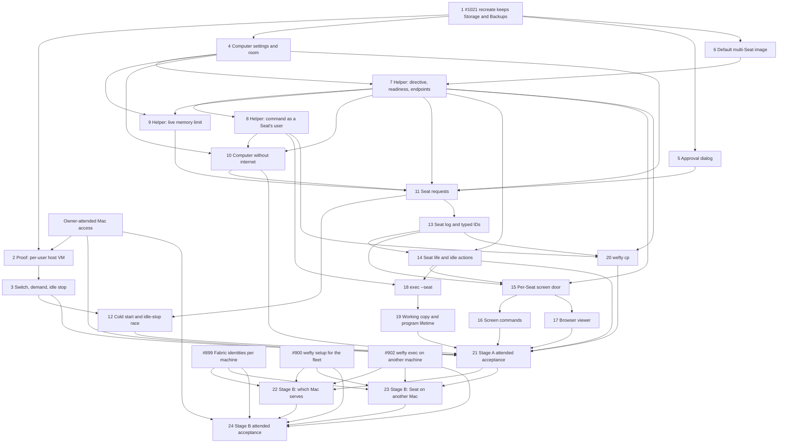

# Computer request implementation wave draft

This is paste-ready issue text, not implementation. It builds the spec `docs/specs/2026-10-21-computer-request-spec.md` (map [#1008](https://github.com/Derek-X-Wang/wefty/issues/1008), destination ticket [#1019](https://github.com/Derek-X-Wang/wefty/issues/1019)). Titles are stable dependency keys: copy every `Blocked by:` title exactly when you create the GitHub dependency edges. Ticket 1 already exists as [#1021](https://github.com/Derek-X-Wang/wefty/issues/1021). Create the other tickets only after the owner ratifies the spec.

> **Status:** draft for ratification, with the spec.

## Wave rules

- **Order: #1021 first; the proof before any ticket that builds on the per-user host VM.** [#1021](https://github.com/Derek-X-Wang/wefty/issues/1021) must land before any delivery work that sets up or recreates the host VM ([#1019](https://github.com/Derek-X-Wang/wefty/issues/1019)). The proof ticket (Ticket 2) blocks the host VM ticket (Ticket 3), and through it the cold-start ticket (Ticket 12) and the stage A acceptance (Ticket 21). Tickets that do not touch the host VM setup wait only on Ticket 1 or on their own code dependencies. Stage B tickets come last.
- **Stage B tickets carry the fleet dependencies** [#899](https://github.com/Derek-X-Wang/wefty/issues/899), [#900](https://github.com/Derek-X-Wang/wefty/issues/900) and [#902](https://github.com/Derek-X-Wang/wefty/issues/902). Stage A tickets do not ([#1018](https://github.com/Derek-X-Wang/wefty/issues/1018)).
- **Size.** Each ticket fits about one AI agent session and lands its own acceptance slice.
- **Tests check what an owner or an AI agent can see:** files, commands, exit codes, CLI output, L1 state and Seat log lines. Each new test fails on the code before the change ([#893](https://github.com/Derek-X-Wang/wefty/issues/893), testing decisions).
- **Lanes** (spec, section 11.1). Every code ticket grows the tagged `service_acceptance` suite. Linux runtime behaviour also grows the real-time Linux lane. Mac behaviour is proved only in attended runs on the owner's Mac, each with the owner's approval, at a quiet time, with the memory guard on. GitHub's Mac runners cannot run a VM. A check that could not run is `NOT-RUN`, never PASS.
- **Docs land with their code:** contracts, OpenAPI, schema, state machines, helper protocol, CLI usage and the wefty skill. A contract-doc change also runs the contract tests in `./scripts`.
- **A new exit code** needs a typed-exit whitelist entry and a real-binary test (#893, seam 1).
- **No ticket adds** a `kind=computer`, a `computers` CLI family, a wait queue, a wefty MCP server, a CDP relay, a proxy or a DNS and IP filter in the guest, public ingress, or a second removal state machine.
- **Open points first.** A ticket that depends on an open point (spec, section 13.1) asks the owner before it builds that part. A "proposed" mechanism (spec, section 13.2) is built as written once the owner ratifies the spec.
- **Vocabulary.** Write "AI agent" and "node agent", never a bare "agent". Never call a Computer a VM.
- **Commits** are DCO-signed and have a why body.

## Decisions this wave rests on

All are closed: charting decisions 1–14 on map [#1008](https://github.com/Derek-X-Wang/wefty/issues/1008), and tickets [#1014](https://github.com/Derek-X-Wang/wefty/issues/1014), [#1017](https://github.com/Derek-X-Wang/wefty/issues/1017), [#1025](https://github.com/Derek-X-Wang/wefty/issues/1025), [#1052](https://github.com/Derek-X-Wang/wefty/issues/1052), [#1026](https://github.com/Derek-X-Wang/wefty/issues/1026), [#1028](https://github.com/Derek-X-Wang/wefty/issues/1028), [#1015](https://github.com/Derek-X-Wang/wefty/issues/1015), [#1016](https://github.com/Derek-X-Wang/wefty/issues/1016), [#1027](https://github.com/Derek-X-Wang/wefty/issues/1027) and [#1018](https://github.com/Derek-X-Wang/wefty/issues/1018). The spec's section 12 links each decision, and its section 12.2 records the points that review round 1 settled.

The wave has 24 tickets: 1 existing ticket, 1 proof ticket, 19 stage A tickets and 3 stage B tickets.

## Ticket list

| # | Title | Blocked by |
|---|---|---|
| 1 | #1021 Host VM recreate keeps the Computers' Storage and Backups | — |
| 2 | Proof: the host VM runs from the per-user install on the owner's Mac | 1 |
| 3 | Host VM switch with three positions, node-owned demand and a gentle idle stop | 2 |
| 4 | Computer settings and room per Seat | 1 |
| 5 | The owner's approval dialog on the Mac | 1 |
| 6 | Default multi-Seat Computer image and Seat conformance | 1 |
| 7 | Helper: Seat directive, readiness and per-Seat endpoints | 4, 6 |
| 8 | Helper: a command as a Seat's user inside a running Computer | 7 |
| 9 | Helper: the live memory limit of a running Computer | 4, 7 |
| 10 | A Computer without internet | 4, 7, 8 |
| 11 | Seat requests: one ID, room check, approval and start | 4, 5, 7, 9, 10 |
| 12 | Cold start: L1 wait hint, the idle-stop race and the stopped-host-VM reply | 3, 11 |
| 13 | Seat log, `wefty logs SEAT_ID` and typed IDs | 11 |
| 14 | Seat life: release, check-ins, end, cleanup and idle actions | 7, 13 |
| 15 | Per-Seat screen door: Controller tenure, driver signal and AI agent input | 7, 13, 14 |
| 16 | `wefty` screen commands for AI agents | 15 |
| 17 | The owner's browser viewer | 15 |
| 18 | `wefty exec --seat`: Runs inside a Seat | 8, 14 |
| 19 | Seat working copy and program lifetime | 18 |
| 20 | `wefty cp`: copies in and out of a Seat | 7, 8, 13 |
| 21 | Stage A attended acceptance on the owner's Mac | 3, 10, 12, 14, 16, 17, 19, 20 |
| 22 | Stage B: which Mac serves a Seat request | 21, #899, #900, #902 |
| 23 | Stage B: an AI agent uses a Seat on another Mac | 21, #899, #900, #902 |
| 24 | Stage B attended acceptance on two Macs | 22, 23, #899, #900, #902 |

## Dependency graph

## Ticket 1 — #1021 Host VM recreate keeps the Computers' Storage and Backups

This ticket already exists: [#1021](https://github.com/Derek-X-Wang/wefty/issues/1021) (on GitHub: "Lima template recreate deletes stopped Computers' Storage and Backups without a guard"). Add this text to it; do not cut a new ticket.

### Question

How does every path that recreates the host VM keep the Computers' Storage and Backups?

### Deliverable

- Today `wefty node setup-oci --recreate` checks only that no OCI attempt runs (`runner/ocicontrol/convergence.go`), then deletes the host VM. Storage and Backups live on the host VM's disk, so stopped Computers lose both.
- The recreate guard refuses while any Computer Storage generation or Backup copy lives on the host VM's disk. The refusal is typed and names what blocks it. The acknowledged-loss option of the issue is dropped, because [#1016](https://github.com/Derek-X-Wang/wefty/issues/1016) and [#1027](https://github.com/Derek-X-Wang/wefty/issues/1027) say a recreate keeps Storage and Backups (spec, section 12.2).
- Every path that recreates the host VM uses the same guard, including the per-user install of Ticket 2.
- The rule lands in `docs/contracts/agent-local-lifecycle.md`.

### Acceptance

- A recreate with only stopped Computers is refused, and their Storage and Backups stay. The test fails on today's code first.
- A recreate with no Storage and no Backup still works.
- The refusal has an exit code in the whitelist and a real-binary test.

### Out-of-scope

Moving Storage or Backups off the host VM's disk. A recreate that accepts a recorded loss.

**Spec sections:** §8, §9.6.

**Blocked by:** —

## Ticket 2 — Proof: the host VM runs from the per-user install on the owner's Mac

### Question

Can a `vz` host VM start and stop from the per-user LaunchAgent install, with no admin password? What does it cost on the owner's Mac?

### Deliverable

- `wefty setup` can add the host VM to the per-user install ([#1027](https://github.com/Derek-X-Wang/wefty/issues/1027)): Lima from Homebrew with no sudo; the node agent's per-user LaunchAgent supervises the host VM; the guest helper installs as the guest's root. The host VM size follows the spec's section 3: a quarter of the Mac's memory and 4 CPUs.
- The install writes today's OCI intent marker. Ticket 3 adds the three positions.
- An attended runbook in `docs/acceptance/` for the owner's Mac: a quiet time, the memory guard on, and a stop rule if the Mac's memory runs short.
- The measurements PR-1 to PR-5, with the method of research [#1010](https://github.com/Derek-X-Wang/wefty/issues/1010) (M1 to M4): the cold start with each step timed, 5 runs; a graceful `limactl stop` against `--force`; the Mac's memory in four states; the host VM's disk file over 10 Computer create and delete cycles.
- **Fallback.** If PR-1 fails, this ticket lands the fallback instead: the host VM alone uses today's LaunchDaemon install, and the rest of the daily install stays per-user. The ticket records why the proof failed.

### Acceptance

- PR-1 passes on the owner's Mac, or the fallback runs and the failure is recorded.
- PR-2 to PR-5 are recorded with their conditions; a measurement that did not run is `NOT-RUN` with its cause.
- Injected service-manager tests ([#893](https://github.com/Derek-X-Wang/wefty/issues/893), seam 2) cover the rendered LaunchAgent, a second run that changes nothing, and `--remove`. No real launchd in CI.
- The run never crosses the memory guard.

### Out-of-scope

On-demand start and stop (Tickets 3 and 12). Seats.

**Spec sections:** §9.6, §11.12.

**Blocked by:** #1021 (on GitHub: "Lima template recreate deletes stopped Computers' Storage and Backups without a guard"); Owner-attended Mac access.

## Ticket 3 — Host VM switch with three positions, node-owned demand and a gentle idle stop

### Question

How does the node keep the host VM on only while work needs it, without overriding the owner's switch?

### Deliverable

- **The switch** gets three positions: *off*, *on demand* (the new default) and *always on* ([#1027](https://github.com/Derek-X-Wang/wefty/issues/1027)). Today's marker maps as the spec proposes (P14). The command that sets a position replaces today's `wefty node oci start|stop` shape; its name is open point 2.
- **Demand, computed by the node** and never written into the intent: a running Computer; an OCI one-shot; queued OCI work that waits for this node (the hint from Ticket 12; a fake until then); an unfinished helper directive (removal, Backup, prune, restore, clone, reset, grow); an owner `load-image`.
- **The idle stop**, 10 minutes after the last demand ends (a setting): publish the reduced capability and wait for L1's acknowledgement; check demand again under the claim lock; take the cycle lock; run a graceful `limactl stop`, with `--force` only after a timeout. Raise today's 30 s Lima command timeout for this step.
- **The reason `host_vm_idle`**: `wefty node doctor` treats it as healthy, never starts the host VM, and shows what keeps it on. The watchdog still repairs a broken host VM.
- **A free-space check** on the Mac before the host VM starts.
- ***off*** ends running work at once, as `oci stop` does today, and lists what it ended.
- The rules land in `docs/contracts/agent-local-lifecycle.md`.

### Acceptance

- HV-1, HV-2, HV-3 and HV-6, with injected clocks and a fake Lima runner in CI.
- On the owner's Mac (attended): HV-1 and HV-3 live, with an owner-made Computer.
- A process job cannot change demand through the operator control socket.

### Out-of-scope

The L1 hint, the start race and the Seat request reply (Ticket 12).

**Spec sections:** §9.2, §9.3, §9.5, §11.11.

**Blocked by:** Proof: the host VM runs from the per-user install on the owner's Mac.

## Ticket 4 — Computer settings and room per Seat

### Question

How do L1 and the node record a Computer's Seat limit, idle action and network? How does a Mac count room in Seats?

### Deliverable

- **Computer settings:** Seat limit, idle action (*delete*, *stop*, *nothing*) and network (*with internet*, *without internet*, fixed at creation). The image digest is recorded at creation, as today. Owner-made Computers take *nothing* and *with internet*.
- **The default Computer image** as a setting that the owner may change (spec P10). A new on-demand Computer takes the newest default at its creation.
- **Room per Seat**, 1 GiB each (a setting). A Seat takes its room when it starts and gives it back after its cleanup is confirmed. The serving Mac counts room node-locally, so the count works while the host VM is stopped.
- **The ceiling** is the host VM's memory minus 1 GiB, read from the configured host VM size. It replaces the fixed 4 GiB and the quarter reserve (`DefaultMacComputerCapacity`). This ticket changes no host VM setup; Ticket 2 sets the size default.
- **The dedicated cap**, 1 by default. It counts the dedicated Computers that run now and that a Seat request made.
- **The Computer count** follows the room (spec P11).
- **Owner-made Computers** keep their own memory limit, 1 GiB by default, and use the same room. Their Seat limit, idle action *stop*, and how wefty knows that their image supports Seats are open point 3: ask the owner first.
- The rules land in `docs/contracts/state-machines.md` and the M3.5 §4 amendment.

### Acceptance

- RM-3 at the room check.
- A room matrix for a 16 GiB and a 32 GiB Mac: 3 and 7 Seats, in any mix of shared and dedicated Computers.
- A fourth Seat's room check on a 16 GiB Mac refuses at once (RM-1 runs live in Ticket 21).
- The room count is right with the host VM stopped. Today's Computers keep working unchanged.

### Out-of-scope

The live memory limit in the helper (Ticket 9). The request flow (Ticket 11).

**Spec sections:** §1.2, §3, §8.

**Blocked by:** #1021 (on GitHub: "Lima template recreate deletes stopped Computers' Storage and Backups without a guard").

## Ticket 5 — The owner's approval dialog on the Mac

### Question

How does the node agent ask the owner Approve or Deny, so that nothing an AI agent can run gives approval?

### Deliverable

- **The dialog** (spec P4): a native macOS alert that the node agent shows in the owner's login session. It shows the harness label ("not verified"), the folder, the request form ("and start it" for a stopped Computer), the network, and a window's length. Two buttons only.
- **The wait:** 5 minutes (a setting), then "no answer from the owner". When nobody is logged in or the screen is locked, the request waits, then is refused the same way.
- **Approval windows:** 1, 8 or 24 hours, never longer (settings). A window covers every request form for its network, and requests without internet (spec, section 12.2). `wefty status` shows an open window. A command closes a window early (spec P1). No command opens one.
- **The answer goes to L1 under the node agent's own identity.** No CLI command and no control-socket verb carries an approval.
- An interface that Ticket 11 calls, and a fake dialog for CI.

### Acceptance

- AP-4: a test walks every `wefty` command and every control-socket verb and finds none that approves.
- AP-5 and AP-6 with a fake dialog and an injected clock.
- On the owner's Mac (attended): the real dialog appears, Deny refuses, and no answer refuses after the wait.

### Out-of-scope

Touch ID or a password. Approval from a phone. Which Mac serves a request (Ticket 22).

**Spec sections:** §2.3, §11.4.

**Blocked by:** #1021 (on GitHub: "Lima template recreate deletes stopped Computers' Storage and Backups without a guard").

## Ticket 6 — Default multi-Seat Computer image and Seat conformance

### Question

What does the default Computer image hold, and how does conformance prove its Seat duties?

### Deliverable

- **The default Computer image** (spec P10; its tool list is open point 5), built from `examples/computer/` and published digest-pinned for amd64 and arm64 through the existing acceptance-image CI. The throwaway prototype on branch `prototype/multi-seat-image` (`prototype/multi-seat-computer/`) shows one way to build it, and a harness that runs it under the real Computer profile.
- **Its Seat duties** ([#1028](https://github.com/Derek-X-Wang/wefty/issues/1028)): a root supervisor that follows the Seat directive (P5) and writes ready or failed answers (P6); Seat users `seat1` to `seat4`, each with a passwd entry; per Seat, its own display and key, a 1280×800 desktop with a browser, view and control endpoints as Unix sockets (P7), a reader of its own `driver.json` (P8), and its folders (P9); on Seat end, every process of the Seat's user stops, double-forked ones included, its folder is deleted and its endpoints are freed; after a Computer restart, no Seats.
- **Temp space sizing** (engineering, spec section 12.2): memory-backed temp space fits inside the Computer's memory limit, for example each Seat's temp folder on its disk folder, as the prototype did. Record the sizes chosen.
- **`wefty-computer-conformance` Seat checks**, with negative fixtures: a Seat user with no passwd entry, and a Seat endpoint that another Seat can open.
- **Measurements:** what a typical install, such as a browser test kit, adds to a Seat's folder.
- `docs/contracts/computer-image.md` gains the Seat section.

### Acceptance

- IM-1, IM-2, IM-4, IM-5 and IM-6 on the real-time Linux lane, under the real Computer profile, with a harness like the prototype's.
- The temp-space sizes and the install measurement are recorded.

### Out-of-scope

The helper operations (Tickets 7 to 9). The owner's setting for another default image (Ticket 4).

**Spec sections:** §7, §8, §11.8.

**Blocked by:** #1021 (on GitHub: "Lima template recreate deletes stopped Computers' Storage and Backups without a guard").

## Ticket 7 — Helper: Seat directive, readiness and per-Seat endpoints

### Question

How do the helper and the node agent add, show and remove a Seat on a running Computer?

### Deliverable

- **Helper operations** (`docs/contracts/oci-helper-protocol.md`): write the Seat directive, with the control folder mounted (spec P5); read the ready or failed answers (P6) and check each Seat's endpoints within its own readiness deadline, which starts when the directive adds the Seat; return per-Seat endpoints and dial them by Seat for the front door (P7); confirm a Seat's cleanup: no processes, no sockets, no folder.
- **The shared folder** and Seat folders on the Computer's Storage (P9).
- **The node agent** applies L1's Seat list for a Computer and reports each Seat's ready, failed and cleaned states to L1.

### Acceptance

- IM-5 through the helper.
- A Seat whose image never answers fails at its own deadline, and a Seat added later is not judged by the Computer's start deadline.
- On the real-time Linux lane.

### Out-of-scope

Commands as a Seat's user (Ticket 8). The live memory limit (Ticket 9). When a Seat ends (Ticket 14). The screen door (Ticket 15).

**Spec sections:** §7, §8.

**Blocked by:** Computer settings and room per Seat; Default multi-Seat Computer image and Seat conformance.

## Ticket 8 — Helper: a command as a Seat's user inside a running Computer

### Question

How does the helper run a command inside a running Computer as a Seat's user, in its folder, with its screen?

### Deliverable

- **A helper operation** that runs a command inside the running Computer as a Seat's Linux user, in the Seat's folder, with the Seat's display and only the Seat's environment ([#1026](https://github.com/Derek-X-Wang/wefty/issues/1026)). containerd can do it (`ctr task exec --user`); the helper and the node agent cannot yet.
- Exit status, output streaming to the Run's log, and cancel.
- A background program that the command starts keeps running after the command ends; the Seat's end stops it (with Ticket 7's cleanup).

### Acceptance

- IM-3.
- A cancelled command stops; a double-forked background program outlives the command and stops when the Seat is removed.
- On the real-time Linux lane.

### Out-of-scope

The `wefty exec --seat` CLI and Run records (Ticket 18). The working copy (Ticket 19).

**Spec sections:** §5.1, §5.3, §8.

**Blocked by:** Helper: Seat directive, readiness and per-Seat endpoints.

## Ticket 9 — Helper: the live memory limit of a running Computer

### Question

How does a shared Computer's memory limit grow when a Seat joins and shrink after a Seat's cleanup, without a restart?

### Deliverable

- **A helper operation** that changes a running Computer's memory limit and reads it back, like today's `memory.max` set before `Started` ([#1015](https://github.com/Derek-X-Wang/wefty/issues/1015)).
- Grow before a Seat starts; shrink only after its cleanup is confirmed, so room returns after cleanup.
- A failed change refuses the Seat with the reason and leaves the old limit.

### Acceptance

- RM-5 on the real-time Linux lane.
- A shrink never goes below the memory that the remaining Seats hold.

### Out-of-scope

Room accounting (Ticket 4). The request flow (Ticket 11).

**Spec sections:** §3, §8.

**Blocked by:** Computer settings and room per Seat; Helper: Seat directive, readiness and per-Seat endpoints.

## Ticket 10 — A Computer without internet

### Question

How does a Computer get a loopback-only network, while its screen, its commands and its copies still work?

### Deliverable

- **The network *without internet*:** loopback only ([#1017](https://github.com/Derek-X-Wang/wefty/issues/1017)). The helper still reaches the screen endpoints and runs commands from outside the Computer's network namespace.
- **Health checks and readiness** do not treat the missing network as a fault.
- **No proxy and no DNS or IP filter** in the guest, as the M3.5 spec rules.
- The rule lands in `docs/contracts/computer-image.md` (OCI profile).

### Acceptance

- AP-2 and AP-3.
- AP-1 at the helper level: the screen endpoints answer, a command runs as a Seat's user, and a file moves in and out. The end-to-end form runs in Ticket 21.

### Out-of-scope

A domain list inside a Computer. A port relay from the Mac.

**Spec sections:** §8, §11.4.

**Blocked by:** Computer settings and room per Seat; Helper: Seat directive, readiness and per-Seat endpoints; Helper: a command as a Seat's user inside a running Computer.

## Ticket 11 — Seat requests: one ID, room check, approval and start

### Question

How does a Seat request go from the AI agent's call to a ready Seat or a refusal, with one dialog and nothing left behind?

### Deliverable

- **Records in L1:** the Seat request and the Seat share one ID, `seat_<32 hex>` (spec P2; section 12.2). The request prints it at once; once approved, it names the Seat; a refused request keeps it in its record. A cut-off call waits again by that ID, on the model of the dispatch-key replay. The harness label is stored, marked not verified.
- **CLI** (spec P1): `wefty seat request` and `wefty seat wait SEAT_ID`. A request without a network is a usage error that shows the fix. Both networks work, because Ticket 10 lands first.
- **The Seat credential:** L1 mints it, and the CLI stores it (spec P3). Check the storage place inside the Claude Code and Codex sandboxes.
- **The flow** (spec, sections 2.2 to 2.4): the room check and the other checks before the dialog (P12); the dialog through Ticket 5, the first approved request takes the room; the start by form, *by name* with its refusals and "and start it"; the newest default image and 8 GiB of Storage for a new on-demand Computer; a new Computer that fails to start is deleted with its Storage and nothing latches, an existing one keeps today's latch. This ticket runs on a running host VM; Ticket 12 adds the stopped-host-VM path.
- **Typed refusals** in `docs/contracts/cli-errors-and-request-ids.md`: out of room ("out of room, try again later"), no answer from the owner, denied, network mismatch, image without Seats, dedicated cap, failed or removed Computer.
- **The wefty skill:** how to request and wait, and that the network must be named.

### Acceptance

- SL-1 and SL-2.
- RM-1 with fakes (live in Ticket 21), RM-2, RM-3 and CT-6 end to end.

### Out-of-scope

The stopped host VM (Ticket 12). Release and the Seat's end (Ticket 14). The screen (Tickets 15 and 16).

**Spec sections:** §1.4, §1.5, §2.1–§2.4, §6.4, §11.5, §11.9.

**Blocked by:** Computer settings and room per Seat; The owner's approval dialog on the Mac; Helper: Seat directive, readiness and per-Seat endpoints; Helper: the live memory limit of a running Computer; A Computer without internet.

## Ticket 12 — Cold start: L1 wait hint, the idle-stop race and the stopped-host-VM reply

### Question

How does a Seat request reach a stopped host VM, and how does it never fail because of an idle stop?

### Deliverable

- **The L1 hint** rides the existing claim poll. L1 sends it to a node that does not advertise `kind:oci` when queued work would be claimable with it: a Computer pinned to that node and desired `running`, or queued `kind=oci` work whose tags match. A Linux node ignores it.
- L1 shows such work as "host VM starting", not unschedulable, while the node reports `host_vm_idle`.
- **The Seat request reply** "starting the host VM, about 1 minute", and a refusal with the reason 3 minutes after the owner's approval (a setting) ([#1015](https://github.com/Derek-X-Wang/wefty/issues/1015)).
- **The race rule** ([#1027](https://github.com/Derek-X-Wang/wefty/issues/1027)): a stop that has not started to shut the host VM down is cancelled; a shutdown that started finishes, and then the host VM starts again.
- **A start that fails** refuses the request with the node's reason and the fix, for example "run `wefty node doctor`".
- **The switch at *off*** refuses a Seat request at once with "the host VM is off".

### Acceptance

- HV-4 and HV-5.
- RM-4 with fakes; the live form runs in Ticket 21.
- A race matrix with injected clocks: a request before, during and after each step of the idle stop.
- A node in `host_vm_idle` never shows its queued work as unschedulable.

### Out-of-scope

The switch and the idle stop (Ticket 3).

**Spec sections:** §2.4, §9.4, §9.5, §11.9, §11.11.

**Blocked by:** Host VM switch with three positions, node-owned demand and a gentle idle stop; Seat requests: one ID, room check, approval and start.

## Ticket 13 — Seat log, `wefty logs SEAT_ID` and typed IDs

### Question

How does one `wefty logs ID` read a Run or a Seat? How does every Seat reply tell the AI agent about unread events?

### Deliverable

- **The Seat log in L1**, one record with the take-over audit, kept 90 days ([#1016](https://github.com/Derek-X-Wang/wefty/issues/1016)). An event writer that other tickets use: request and release, the end and its reason, owner stop and restart, commands started and finished, copies, control taken and released with the note.
- **`wefty logs ID`** reads the kind from the ID's prefix. `--follow`, `--cursor` and `--tail` work for Runs and Seats. A Seat follow stops when the Seat ends, and its last line says why.
- **After the Seat ends**, its credential still reads that Seat's log, read-only, for the log's retention, and does nothing else (spec P15).
- **The unread-events line** on every Seat reply, in one shared reply path.
- **Typed-ID parsing**, shared with `wefty cancel`.

### Acceptance

- LG-1 and LG-4.
- After the end, the credential reads the log but cannot run a command, send input, copy or open the screen.
- Today's `wefty logs RUN_ID` tests pass unchanged.

### Out-of-scope

Check-ins and the "ends soon" event (Ticket 14). Other `wefty logs` targets.

**Spec sections:** §2.6, §6, §11.6.

**Blocked by:** Seat requests: one ID, room check, approval and start.

## Ticket 14 — Seat life: release, check-ins, end, cleanup and idle actions

### Question

When does a Seat end, what ends with it, and what does wefty do with an idle Computer?

### Deliverable

- **`wefty seat release SEAT_ID`** (spec P1), and the wefty skill text for release.
- **The alive rule** ([#1025](https://github.com/Derek-X-Wang/wefty/issues/1025)): a Seat call in the last 30 minutes (a setting), a running command (Ticket 18 feeds it), or a person driving (Ticket 15 feeds it). A Seat call is every one-time Seat command with the credential, a one-time `wefty logs SEAT_ID` included; a `--follow` counts once, when it starts (spec, section 12.2).
- **The "ends soon" event**, once, 5 minutes before the end (a setting).
- **The end:** release, expiry, a Computer restart, or an owner command. Cancel its commands, stop its programs, delete its folder, and stop its credential at once for everything but reading its log ("Seat ended" with the reason). Return its room only after the helper confirms the cleanup.
- **The owner's commands** (`stop`, `restart`, `reimage`, `reset`, `remove`) run at once, end the Seats, and list them in their output. Each Seat's log says why.
- **The idle timer**, 10 minutes after the last Seat leaves (a setting), and the idle actions: *delete* through today's removal path to `removed_verified`, *stop*, and *nothing*. A Seat before the idle action starts cancels the timer; after it starts, the request gets another Computer or "out of room". An owner-stopped Computer is never deleted by the timer. A changed setting applies at the next check.

### Acceptance

- SL-3, SL-4, LG-2 and LG-3.
- CT-1, CT-2, CT-3, CT-4 and CT-5.
- A one-time `wefty logs SEAT_ID` resets the 30 minutes; a long `--follow` does not.
- An expired Seat's credential gets "Seat ended: expired" at once.

### Out-of-scope

The viewer's notice (Ticket 17). The host VM stop (Ticket 3).

**Spec sections:** §2.5–§2.7, §8, §11.5, §11.6, §11.10.

**Blocked by:** Helper: Seat directive, readiness and per-Seat endpoints; Seat log, `wefty logs SEAT_ID` and typed IDs.

## Ticket 15 — Per-Seat screen door: Controller tenure, driver signal and AI agent input

### Question

How does the front door give each Seat its own screen and tenure, and an AI agent input path that a person's tenure blocks?

### Deliverable

- **Per Seat:** the front door's screen endpoints (from Ticket 7), Controller tenure, and the driver signal (spec P8), true only while a person holds the tenure.
- **The AI agent's input path**, with the Seat credential. While a person holds the tenure, it is refused with "a person is driving". Screenshots still work. Through wefty, an AI agent reaches only its own Seat.
- **The person path** keeps today's rules (admins only, view first, an explicit take, the one-hour limit), now per Seat. Computers with an older image keep per-Computer tenure.
- **The audit** records which path each input took. Control taken and released, with the release note, go to the Seat's log. Wefty records no clicks, keys or screen contents.
- **A person driving keeps the Seat alive** (feeds Ticket 14). **The release note** reaches the AI agent on its next action.

### Acceptance

- AR-2 at the front door, with fixtures.
- Taking one Seat leaves the other Seats working.
- One Seat's credential cannot reach another Seat's screen (IM-4 through the door).

### Out-of-scope

The CLI screen commands (Ticket 16). The browser viewer (Ticket 17). A person proof on Take control.

**Spec sections:** §4.3, §4.4, §8.

**Blocked by:** Helper: Seat directive, readiness and per-Seat endpoints; Seat log, `wefty logs SEAT_ID` and typed IDs; Seat life: release, check-ins, end, cleanup and idle actions.

## Ticket 16 — `wefty` screen commands for AI agents

### Question

How does an AI agent take screenshots, and click, type and scroll on its Seat, from its own shell?

### Deliverable

- **CLI** (spec P1): screenshot (a PNG file), click (left, right, double), move, drag, scroll, type and key. An action may take a screenshot in the same call. The screen is 1280×800.
- **The refusal** "a person is driving" is typed, with an exit code in the whitelist and a real-binary test. The unread-events line comes on every reply.
- **The wefty skill:** read a screenshot with the harness's own image tool; do not drive the screen with commands while a person drives.
- **Two timings with their proposed thresholds** (spec P16): SC-1 (wefty's own part of one click with its screenshot, within 1 s) and SC-4 (Take control to the first refusal, within 1 s), on the owner's Mac without model time. Over a threshold, the check fails, and the CDP relay comes back for the owner's decision.

### Acceptance

- SC-1 and SC-4 recorded against their thresholds.
- AR-2 from the CLI.
- A screen command on another AI agent's Seat is refused.

### Out-of-scope

The 10-step test and its Playwright comparison, SC-2 and SC-3 (Ticket 21). A wefty MCP server. A CDP relay.

**Spec sections:** §4.1, §4.5, §11.3.

**Blocked by:** Per-Seat screen door: Controller tenure, driver signal and AI agent input.

## Ticket 17 — The owner's browser viewer

### Question

How does the owner watch a Seat live and take the wheel from a browser?

### Deliverable

- **The front door serves the viewer page** and gives the browser its session bearer, because a browser cannot read WebSocket response headers.
- **One command opens it** (spec P1).
- **The page** shows the Seat live, who drives (the AI agent or a person), Take control and Release, and a field for the release note. It says when the Seat ended, also after a release while the owner watches.
- **The one-hour limit** stays; the owner reconnects.

### Acceptance

- AR-2 by a person in the viewer (the attended form runs in Ticket 21).
- The viewer shows that the Seat ended after the AI agent releases it.
- A non-admin person is refused.

### Out-of-scope

Grants for other people. A person proof on Take control. The viewer from another Mac (Ticket 23).

**Spec sections:** §4.2, §4.3.

**Blocked by:** Per-Seat screen door: Controller tenure, driver signal and AI agent input.

## Ticket 18 — `wefty exec --seat`: Runs inside a Seat

### Question

How does a command run as an ordinary Run inside a Seat?

### Deliverable

- **`wefty exec --seat SEAT_ID -- <command>`** runs an ordinary Run that records its Seat, through Ticket 8's operation ([#1026](https://github.com/Derek-X-Wang/wefty/issues/1026)). Exit codes, `--detach`, `wefty logs RUN_ID`, `wefty cancel` and `wefty results` work as for `wefty exec`.
- **Outside a Git checkout** the command runs in the Seat's folder with no copy. Plain `wefty exec` still refuses there.
- **The environment** is the Seat's only.
- **The time limit:** 1 hour by default (a setting). `--max-runtime` sets another limit; `--max-runtime 0` is refused. At the limit only the command stops, recorded as `fail` with no exit code, and the CLI and the Seat's log give the fix. No warning and no extend.
- **`wefty rerun`** refuses a Seat Run.
- **A running command keeps the Seat alive** (feeds Ticket 14).
- **Seat log events:** "started" and "finished", with the Run ID and exit status.
- The rules land in `docs/contracts/exec.md`.

### Acceptance

- CF-4, CF-5, CF-6, CF-7 and CF-10.

### Out-of-scope

The working copy and background programs (Ticket 19). `wefty cp` (Ticket 20). Commands from another Mac (Ticket 23).

**Spec sections:** §5.1, §5.3, §11.7.

**Blocked by:** Helper: a command as a Seat's user inside a running Computer; Seat life: release, check-ins, end, cleanup and idle actions.

## Ticket 19 — Seat working copy and program lifetime

### Question

How does a Seat keep its state between commands: one working copy, its dependencies, and its background programs?

### Deliverable

- **The working copy:** one per Seat, brought up to date before each command. Tracked files and untracked files that Git does not ignore go in, deleted files go away, Git-ignored files on the Seat stay, and the caller's checkout wins ([#1026](https://github.com/Derek-X-Wang/wefty/issues/1026)).
- **Background programs** live until the Seat ends and do not keep it alive.
- The rules land in `docs/contracts/exec.md`.

### Acceptance

- CF-1, CF-2 and CF-3.
- A changed tracked file on the Seat is put back before the next command.

### Out-of-scope

Copies between Macs (Ticket 23).

**Spec sections:** §5.2, §5.3, §11.7.

**Blocked by:** `wefty exec --seat`: Runs inside a Seat.

## Ticket 20 — `wefty cp`: copies in and out of a Seat

### Question

How does an AI agent copy files into and out of its Seat with one command?

### Deliverable

- **`wefty cp SRC SEAT_ID:PATH`** copies in, and **`wefty cp SEAT_ID:PATH DEST`** copies out ([#1026](https://github.com/Derek-X-Wang/wefty/issues/1026)). A relative Seat path starts in the Seat's folder; an absolute path may name any file that the Seat's user can read, the shared folder included.
- **Copy in:** any file that the AI agent can read, Git-ignored files included. Wefty downloads nothing.
- **Copy out:** any file that the Seat's user can read. The CLI writes it inside the AI agent's sandbox.
- **No size limit** on one Mac. A copy that does not fit fails loudly.
- **Not a Custody export**; the removal proof does not change. The rule lands in `docs/contracts/exec.md` and the Custody export contract text.
- **A Seat log event** for every copy, with its path and size. Every copy carries the Seat credential.

### Acceptance

- CF-8 and CF-9.
- A copy that does not fit fails with a clear error.
- A Computer's removal outcome is the same before and after a copy-out.

### Out-of-scope

Copies between Macs (Ticket 23).

**Spec sections:** §5.4, §11.7.

**Blocked by:** Helper: Seat directive, readiness and per-Seat endpoints; Helper: a command as a Seat's user inside a running Computer; Seat log, `wefty logs SEAT_ID` and typed IDs.

## Ticket 21 — Stage A attended acceptance on the owner's Mac

### Question

Does stage A pass the arrival test on the owner's Mac, under the real host VM, dialog, Seats and removal proof?

### Deliverable

- **An attended runbook and tagged harness** in `docs/acceptance/` for the owner's Mac, with the owner's approval, at a quiet time, with the memory guard on.
- **The live rows:** AR-1 to AR-5; AP-1 to AP-6; RM-1 and RM-4; HV-1 to HV-6; CT-1.
- **The screen timing comparison:** SC-2 (the 10-step browser test through the screen) and SC-3 (the same test as a Playwright command on the Seat), time and tokens, recorded side by side for the owner to read, with no threshold; and SC-1 and SC-4 live if not yet recorded.
- **One matrix** that folds the CI, real-time Linux and attended evidence and maps every stage A row of spec section 11 to its proof. A gap goes to its owning ticket. This ticket adds no behaviour.

### Acceptance

- AR-1 to AR-5 pass, with a kept receipt.
- SC-2 and SC-3 are recorded with their conditions.
- Every stage A row has positive evidence, or `NOT-RUN` with its cause. No weakened outcome shows as clean.

### Out-of-scope

Stage B rows. New behaviour.

**Spec sections:** §11.

**Blocked by:** Host VM switch with three positions, node-owned demand and a gentle idle stop; A Computer without internet; Cold start: L1 wait hint, the idle-stop race and the stopped-host-VM reply; Seat life: release, check-ins, end, cleanup and idle actions; `wefty` screen commands for AI agents; The owner's browser viewer; Seat working copy and program lifetime; `wefty cp`: copies in and out of a Seat; Owner-attended Mac access.

## Ticket 22 — Stage B: which Mac serves a Seat request

### Question

How does a Seat request from one Mac reach the Mac that serves it, while the owner still approves on the Mac in front of them?

### Deliverable

- **A per-machine setting** (spec P13): Seat requests go to *this Mac* (the default) or to one named Mac ([#1018](https://github.com/Derek-X-Wang/wefty/issues/1018)). `--node NODE` overrides it for one request. A *by name* request goes to its Computer's node pin.
- **The serving Mac checks room.** A full serving Mac refuses at once, and the refusal names it. Wefty never tries another Mac on its own.
- **The dialog appears on the AI agent's Mac**, never on the hosting Mac. When nobody is logged in to the AI agent's Mac, or the AI agent runs on Linux, the request waits, then is refused. The answer goes to L1 under the AI agent's Mac's node identity.

### Acceptance

- SB-1, SB-2 and SB-3, with two in-process nodes over the plain Fabric. The live forms run in Ticket 24.

### Out-of-scope

Any Mac with room. Approval from a phone or on a node with no dialog.

**Spec sections:** §10.2, §11.13.

**Blocked by:** Stage A attended acceptance on the owner's Mac; Fabric identities per machine: machine participants plus the owner's sign-in, chosen per command (#899); wefty setup for the fleet: control-plane and joining roles on Mac and Linux (#900); wefty exec on another owned machine (#902).

## Ticket 23 — Stage B: an AI agent uses a Seat on another Mac

### Question

How does an AI agent on one Mac use its Seat on another Mac, and reach nothing else there?

### Deliverable

- **Identity:** the Mac's machine identity (the client participant from [#899](https://github.com/Derek-X-Wang/wefty/issues/899)) plus the Seat credential, never the owner's person identity.
- **Only its own Seat, through the front door:** the screen, the commands, the copies and the log. The network policy opens one fixed wefty port from client participants to node agents, not every port. Hosted services stay the owner's alone ([#1049](https://github.com/Derek-X-Wang/wefty/issues/1049)).
- **Copies and the working copy** use the remote `exec` path: 256 MiB per copy, and a waiting file is deleted after 1 hour. The working copy update sends only changed files. A copy that is too big fails, and the error gives the limit.
- **`wefty logs SEAT_ID --follow`, `wefty exec --seat` and `wefty cp`** work the same from another Mac, and so does the viewer from another Mac's browser.
- **Fail closed:** a hosting Mac that loses the control plane stops taking the AI agent's screen input until the connection is back.

### Acceptance

- SB-4, SB-5 and SB-6, with fixtures. The live forms run in Ticket 24.

### Out-of-scope

A port relay. Any other port of the Computer.

**Spec sections:** §10, §11.13.

**Blocked by:** Stage A attended acceptance on the owner's Mac; Fabric identities per machine: machine participants plus the owner's sign-in, chosen per command (#899); wefty setup for the fleet: control-plane and joining roles on Mac and Linux (#900); wefty exec on another owned machine (#902).

## Ticket 24 — Stage B attended acceptance on two Macs

### Question

Does stage B work on two of the owner's Macs, with the dialog on the AI agent's Mac and the Seat on the server Mac?

### Deliverable

- **An attended runbook** for two Macs, with the owner's approval and the memory guard on.
- **The live rows** SB-1 to SB-6, including the owner's drive from the laptop's browser.
- The stage B rows fold into the matrix of Ticket 21.

### Acceptance

- SB-1 to SB-6 pass, with a kept receipt, or show `NOT-RUN` with the cause.

### Out-of-scope

New behaviour.

**Spec sections:** §10, §11.13.

**Blocked by:** Stage B: which Mac serves a Seat request; Stage B: an AI agent uses a Seat on another Mac; Fabric identities per machine: machine participants plus the owner's sign-in, chosen per command (#899); wefty setup for the fleet: control-plane and joining roles on Mac and Linux (#900); wefty exec on another owned machine (#902); Owner-attended Mac access.
